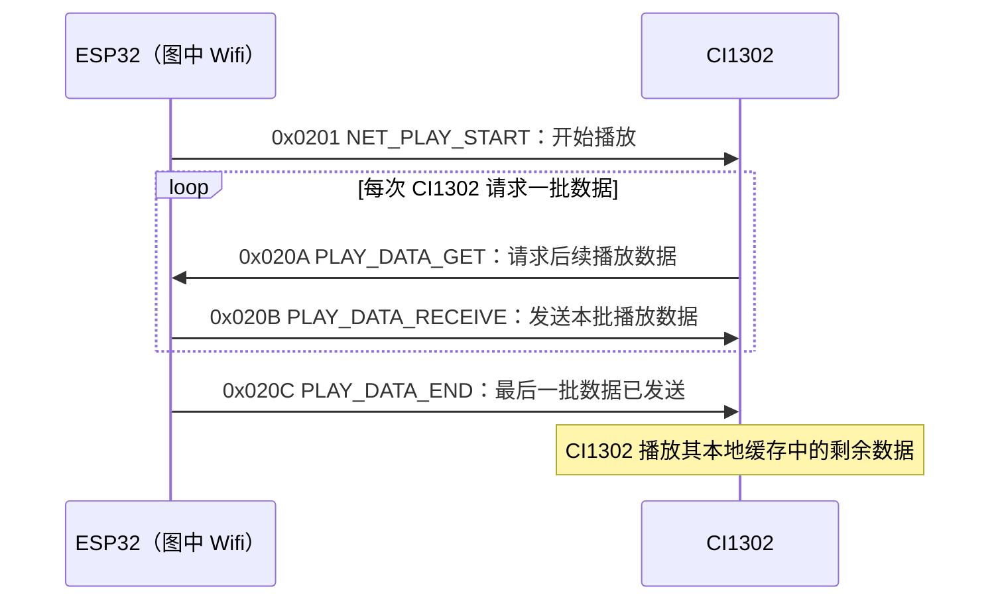

# CI1302 网络流媒体播放交互时序

## 范围与依据

本文整理 CI1302 厂商提供的《数据流-流媒体播放》流程图。流程图中的 `Wifi` 对应本项目的 ESP32。它描述网络流媒体播放的数据请求、数据发送和数据结束通知，不涵盖云端 TTS 解码、录音上传或唤醒状态机。

## 正常交互时序

方向以 ESP32 和 CI1302 为准：`0x0201`、`0x020B`、`0x020C` 是 ESP32 发往 CI1302；`0x020A` 是 CI1302 发往 ESP32。`0x020A` 是由 CI1302 发起的数据请求，因此 ESP32 不能把它当作自己主动发送的控制命令。

## 指令含义与顺序

| 顺序 | 指令 | 方向 | 作用 |
| --- | --- | --- | --- |
| 1 | `0x0201 NET_PLAY_START` | ESP32 → CI1302 | 通知 CI1302 开始网络流媒体播放。 |
| 2 | `0x020A PLAY_DATA_GET` | CI1302 → ESP32 | CI1302 请求后续播放数据；流程图要求与数据发送循环配合。 |
| 3 | `0x020B PLAY_DATA_RECEIVE` | ESP32 → CI1302 | ESP32 按请求发送一批播放数据。 |
| 4 | `0x020C PLAY_DATA_END` | ESP32 → CI1302 | ESP32 已发送完最后一批数据，通知 CI1302 数据流结束；CI1302 随后播放本地缓存的剩余数据。 |

图中的步骤 2 和 3 循环执行。步骤 4 是数据流结束通知，不等于播放已经结束，也不是主动停止指令。ESP32 主动停止播放使用本项目定义的 `0x0204 NET_PLAY_STOP`。播放完成事件（例如 `0x020D PLAY_TTS_END`）应与 `0x020C` 区分。

## 厂商图中的补充说明

- 图示版本标注为 V1.0.5：CI1302 播放期间若启用全双工，新 VAD 数据仍可能上传。
- 厂商提示，大量待播放数据可能超过 Wi-Fi 侧缓冲能力；发送端应按 `0x020A` 请求节奏供数，避免数据缓冲溢出和丢失。
- 图中说明的播放格式为 32 kbps MP3，并提及 CI130X 侧 `AIOT_AUDIO_PLAY_BUF_SIZE` 与 `PLAY_BUF_SIZE_MAX` 缓冲配置。这些是厂商图中的芯片侧说明，不代表 ESP32 当前 PCM/TTS 软件实现使用相同编码或缓冲参数。
- 厂商图指出，在未唤醒状态，CI130X 仍可响应流媒体播放指令。

## 日志分析提示

- `0x0201` 后没有观察到 `0x020A`：请求阶段没有证据，不能推断 ESP32 已进入数据发送循环。
- 收到 `0x020A` 后才应有对应的 `0x020B` 数据响应；项目日志可能只记录请求/数据帧计数，未逐帧打印原始报文。
- 只有数据确实发送完，才应观察到 `0x020C`。没有 `0x020A` 时，通常也不会出现由请求驱动的 `0x020B` 和后续 `0x020C`。
- `0x020C` 只表示数据发送结束；不能单独作为 CI1302 已播放完成的证据。
- 排查时应结合 UART1 原始收发或明确记录 RX `0x020A`、TX `0x020B`/`0x020C` 的日志，以及播放完成事件判断。

