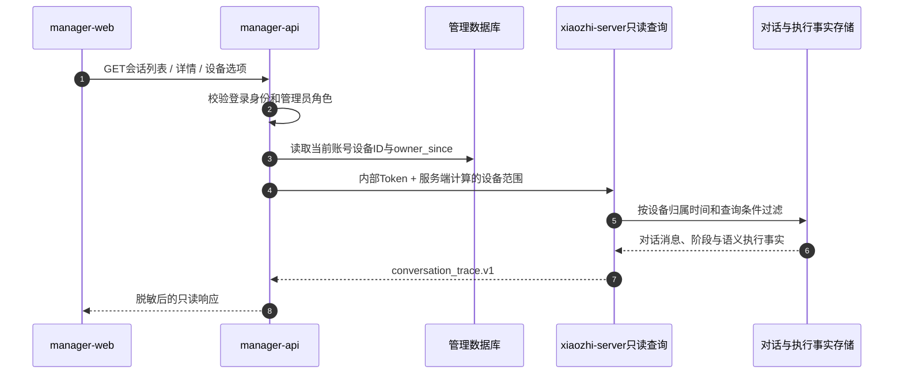

## 内容要求

执行流程目录命名、状态前缀、Markdown格式、流程结构、执行状态和进度字段。不使用为源在文档/流程或法典命令批准之外的代码更改。

### 格式约束

- **内容规范**: 完整句无需额外换行，在一行直接构建

**错误示例**：

```
模糊调节入口（例如“帮我调”“请帮我调整一下”）使用共享的词法语法识别，而不是维护完整
短语白名单。语法由可组合的礼貌前缀、调节动作词、语气后缀和明确对象排除组成；新增表达时
只需扩展动作词或字段别名，后续组合会自动覆盖。没有明确按摩对象时先进入“等待调节字段”
状态并追问力度、部位或时长，带有“空调”“音量”等明确非按摩对象的句子不会被该候选截获。
```

**正确示例**

```
模糊调节入口（例如“帮我调”“请帮我调整一下”）使用共享的词法语法识别，而不是维护完整短语白名单。语法由可组合的礼貌前缀、调节动作词、语气后缀和明确对象排除组成；新增表达时只需扩展动作词或字段别名，后续组合会自动覆盖。没有明确按摩对象时先进入“等待调节字段”状态并追问力度、部位或时长，带有“空调”“音量”等明确非按摩对象的句子不会被该候选截获。
```

- **标题要求**: 使用 `##` 作为标题级别。
- **名称解释**: 流程图、时序图中使用的节点名称、功能流程应有统一说明用途

示例：

"""
- manager-web: 管理前端
- manager-api: 管理API
- xiaozhi-server只读查询: 服务端只读查询用于查询对话与执行事实
- 对话与执行事实存储: 对话与执行事实存储用于存储对话与执行事实


"""

- **流程图表**: 一律使用 mermaid 格式的，优先使用时序图，除非时序图不能表达时才考虑使用流程图
- **版本描述**: 每个流程图版本顶部都需要介绍当前版本、最后更改时间、最近更改点
- **内容结构**: 

```
---
当前版本:
最后更改时间:
最近更改点:
  - 修改了xxx
  - 修改了xxx
---

## 名称说明

## 流程

```

### 流程表达

- **格式要求**: 涉及流程表达时优先使用 mermaid 格式的时序图、流程图来表达。
- **README**: 内容更新后同步更新 docs/interaction-flows/README 文档

## 结构要求

每个流程图需描述为多个版本，进行改造后需迭代版本不在原版本上改造

- **版本迭代定义**: 连续对某个流程图改造不为版本迭代，经过一段时间（3天以上）再修改的流程图才定义为版本迭代
- **结构示例**: 

```
- root \
  - docs \
    - interaction-flows \
      - xxx 方案流程说明1 \
        - v1.0.0.md
        - v1.0.1.md
      - xxx 方案流程说明2 \
        - v1.0.0.md
        - v1.0.1.md
```

